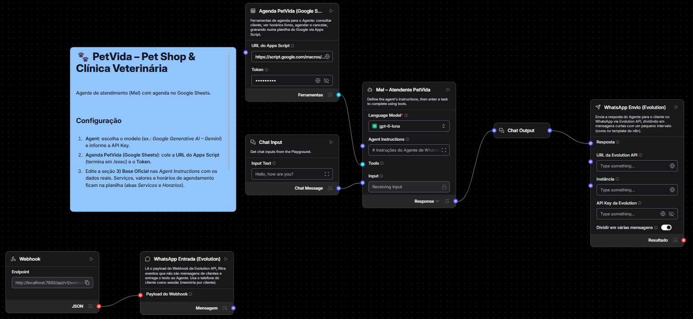
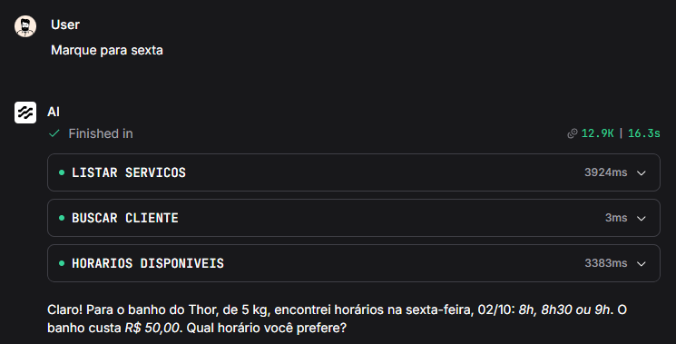
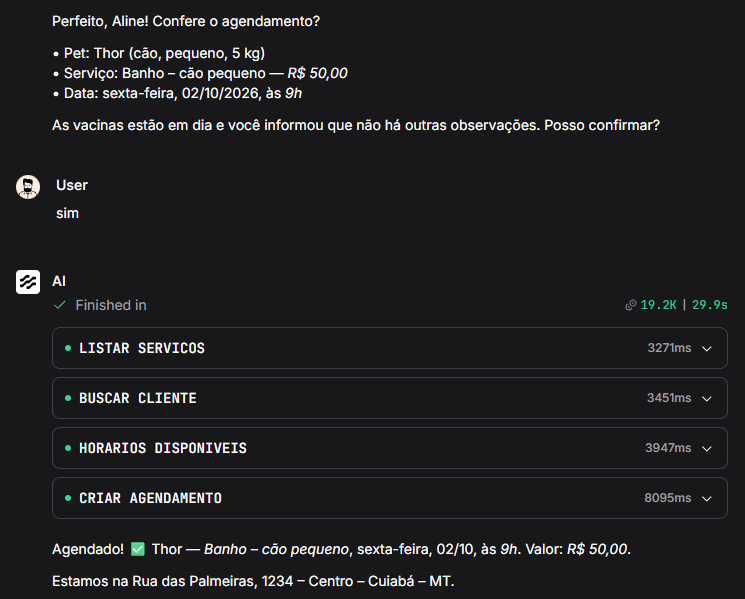
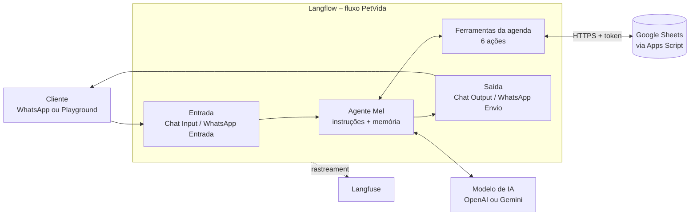
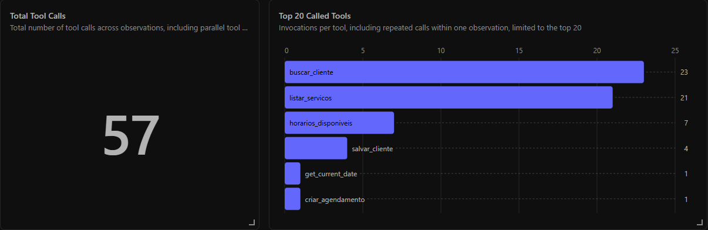
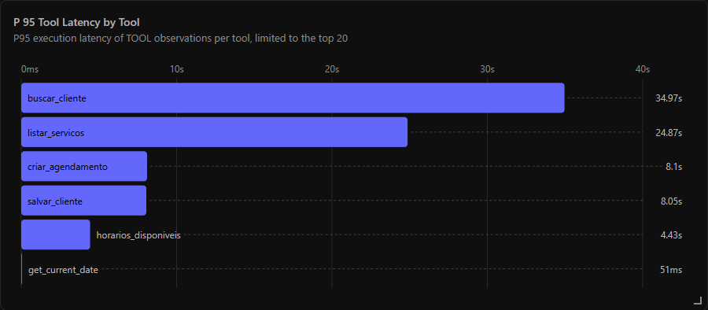
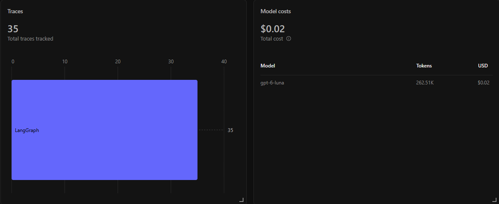

# PetVida – Agente de IA para Pet Shop & Clínica Veterinária

MVP de um agente de atendimento com IA ("Mel") construído no **Langflow**. Ele conversa com o cliente, consulta uma agenda real no **Google Sheets**, grava agendamentos e registra cada decisão no **Langfuse**. A integração com **WhatsApp (Evolution API)** está pronta para ser ligada.

> O PetVida é um negócio fictício, usado para validar um padrão reaproveitável: **agente + instruções + ferramentas de negócio + observabilidade**. Para levar a solução a outra área, trocam-se as instruções e as ferramentas; a arquitetura continua a mesma.



---

## O que o MVP faz

- Atende banho e tosa, consultas, vacinas e dúvidas sobre a loja.
- Coleta os dados em etapas curtas: tutor, pet, espécie, porte, serviço e data.
- Consulta horários livres de verdade e só grava o agendamento depois da confirmação do cliente.
- Faz triagem de urgência e encaminha para a emergência veterinária, sem diagnosticar nem receitar.
- Guarda memória por cliente. No WhatsApp, a sessão é o número do cliente.
- Registra no Langfuse cada mensagem, ferramenta chamada, tempo e custo.

| Consulta de horários | Confirmação e agendamento |
| --- | --- |
|  |  |

## Arquitetura



| Componente | Tecnologia | Papel |
| --- | --- | --- |
| Agente | Langflow 1.12 (Agent) | Decide o que responder e quando usar ferramentas |
| Ferramentas | Componente customizado "Agenda PetVida" | `listar_servicos`, `buscar_cliente`, `salvar_cliente`, `horarios_disponiveis`, `criar_agendamento`, `cancelar_agendamento` |
| Agenda | Google Sheets + Apps Script (App da Web) | Clientes, pets, serviços, horários por recurso e agendamentos |
| Canal | Playground; WhatsApp via Evolution API v2 | Entrada e saída das mensagens |
| Observabilidade | Langfuse Cloud | Traces, custo, latência e uso de ferramentas |

## Técnicas de engenharia de IA

| Técnica | Aplicação |
| --- | --- |
| Prompt de sistema estruturado | Seções numeradas: identidade, tom, base oficial, regras, triagem, fluxo |
| Grounding | Endereço, horários e preços oficiais; é proibido inventar |
| Slot filling | Coleta guiada, pedindo só o dado que falta |
| Tool calling | O agente escolhe entre as 6 ferramentas da agenda |
| Fonte única de verdade | Horários e valores vêm da agenda, nunca do modelo |
| Memória por sessão | Últimas 30 mensagens, isoladas por cliente |
| Guardrails de domínio | Triagem de urgência, sem diagnóstico, confirmação antes de gravar |
| Erros orientados ao modelo | A ferramenta diz o que corrigir e o agente tenta de novo |
| Contrato fechado | Sem SQL livre; o telefone vem da sessão, e não do modelo |

## Observabilidade (Langfuse)







- **Custo:** 35 mensagens de teste custaram cerca de **US$ 0,02** (262,5 mil tokens).
- **Chamadas repetidas:** `buscar_cliente` e `listar_servicos` foram chamadas em quase toda mensagem.
- **Latência:** as consultas à planilha chegam a 35 s no p95.
- **Melhorias previstas:** consultar cliente e serviços uma vez por conversa e usar banco de dados na produção.

## Canais possíveis

O Langflow publica o fluxo como API. Por isso, o mesmo agente pode atender outros canais trocando só a entrada e a saída:

| Canal | Como se conecta |
| --- | --- |
| Site ou portal | Widget de chat do Langflow incorporado na página |
| ERP, CRM ou app interno | Chamada à API do fluxo (`/api/v1/run`) com mensagem e id da sessão |
| Teams, Slack, Telegram | Bot que repassa a mensagem para a API |
| E-mail ou formulário | Automação (n8n ou similar) enviando ao webhook do fluxo |
| Outros agentes de IA | Fluxo publicado como servidor MCP |
| Rotinas agendadas | Chamada periódica à API (lembretes, confirmações) |

## Estrutura do repositório

```
.
├── README.md
├── PetVida_Agente_PetShop_Clinica_Langflow.json   # fluxo para importar no Langflow
├── PetVida_Agenda_AppsScript.gs                   # API da agenda (Google Apps Script)
├── PetVida_Agenda_Planilha.xlsx                   # modelo da planilha da agenda
└── docs/img/                                      # imagens deste README
```

## Como rodar

1. **Planilha**
   - Faça upload de `PetVida_Agenda_Planilha.xlsx` no Google Drive.
   - Abra o arquivo e escolha *Arquivo → Salvar como Planilhas Google*.
2. **Apps Script**
   - Na planilha, abra *Extensões → Apps Script* e cole o conteúdo de `PetVida_Agenda_AppsScript.gs`.
   - Defina um `TOKEN` próprio no código.
   - Publique em *Implantar → Nova implantação → App da Web*, com execução como **Eu** e acesso para **Qualquer pessoa**.
   - Copie a URL que termina em `/exec`.
3. **Langflow (1.12+)**
   - Importe o `.json` pelo ícone ↑ ao lado de *Projects*.
   - No **Agent**, escolha o modelo e informe a API Key.
   - No nó **Agenda PetVida**, cole a URL `/exec` e o token.
4. **Langfuse (opcional)**
   - Crie um arquivo `.env` com as chaves abaixo:
     ```
     LANGFUSE_SECRET_KEY=sk-lf-...
     LANGFUSE_PUBLIC_KEY=pk-lf-...
     LANGFUSE_BASE_URL=https://us.cloud.langfuse.com
     ```
   - Inicie o Langflow com:
     ```
     python -m langflow run --env-file .env
     ```
5. **Teste**
   - No Playground, mande: *"quero marcar banho pro meu cachorro de 5 kg na sexta de manhã"*.
6. **WhatsApp (quando for para produção)**
   - Troque a ligação *Chat Input → Agent* por *WhatsApp Entrada → Agent*.
   - Configure a Evolution API no nó **WhatsApp Envio**.
   - Aponte o webhook da Evolution para o endpoint do nó **Webhook**.

> **Segredos:** nunca versionar `.env`, API Keys ou o `TOKEN` do Apps Script. O `.gitignore` deste repositório já ignora `.env`.

## Roadmap

| Fase | Status | Entregas | Critério para avançar |
| --- | --- | --- | --- |
| 0 · MVP | Concluída | Playground, agenda em planilha, Langfuse | MVP validado |
| 1 · Piloto | Próximo passo | Dados reais, WhatsApp de teste, testes automáticos | Testes aprovados e LGPD revisada |
| 2 · Produção | Planejada | Servidor dedicado, banco de dados, cofre de segredos, atendimento humano | Operação estável e custo conhecido |
| 3 · Plataforma | Planejada | Modelo reutilizável, novas áreas, governança de IA | — |

## Aplicação em outras áreas

| Área | Ação do agente | Guardrail crítico |
| --- | --- | --- |
| Crédito | Informar status da análise e coletar documentos | A IA nunca aprova, nega ou promete crédito |
| Contas a receber e cobrança | Segunda via, registro de promessa de pagamento | Identidade verificada; só condições pré-aprovadas |
| Contas a pagar | Status de nota e de pagamento para fornecedores | Nunca alterar dados bancários por conversa |
| Logística | Agendar janela de descarga | Não confirmar janela sem vaga |
| Manutenção | Abrir ordem de serviço | Encaminhar riscos de segurança |
| RH | Responder dúvidas e abrir solicitações | Dado pessoal só do próprio colaborador |
| Suporte de TI | Resolver ou abrir chamado | Nenhuma ação sem autorização |

---

**Stack:** Langflow · Google Sheets / Apps Script · Langfuse · Evolution API · OpenAI / Gemini
